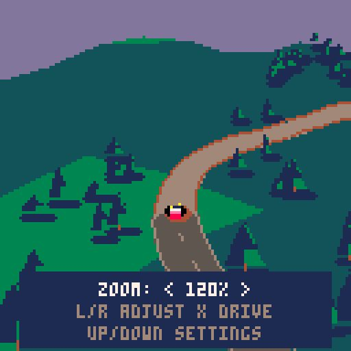

# Quiet Miles

A relaxed PICO-8 rally-driving prototype inspired by Art of Rally. The current
focus is camera position and driving feel: rolling hills, recoverable slides,
and different grip on dirt and pavement. The choice between free roaming and
stages is still open.



## Play

Load [quiet_miles.p8](quiet_miles.p8) in desktop PICO-8 or the
[free Education Edition](https://www.pico-8-edu.com/). In the Education Edition,
press Escape to stop a running cart, type `load`, select the file, then press
Ctrl+R. Press X to leave settings and drive.

| Control | Action |
| --- | --- |
| Left / Right | Steer |
| Z or Up | Accelerate |
| Down | Brake; hold at low speed to reverse |
| X | Handbrake |
| P or Enter | Pause menu: settings, road recovery, restart |

Drive Settings offers two regions, rolling or flat terrain, low or high camera
angles, and 100-150% zoom with a 120% default. Select Zoom for a preview, use
Left/Right to adjust, and press X to resume. Mixed roads alternate dirt and
pavement; Snow Test experiments with low grip on the same landscape.

See [the full controls and comparison guide](docs/PLAY.txt) and
[the research and design notes](docs/research.html).

## Develop

Edit `quiet_miles.p8` directly. It contains the source, generated scenery and
audio definitions, and cartridge data; no build step is needed to play it.
The `docs/` directory contains the prototype notes and native runtime evidence.

Run the existing handling and projection checks from the repository root with
Lua 5.4:

```sh
lua tests/handling.lua
```

The harness reads the cartridge itself and checks surface behavior, braking,
steering, handbrake slip, reverse, terrain effects, recovery and projection.
It uses ordinary Lua numbers and mocked PICO-8 graphics/audio APIs. It cannot
measure native fixed-point behavior or PICO-8 CPU use.

To generate the native performance-check cartridge, use Node.js (no packages
to install):

```sh
node tools/make-sweep.js
```

Load `build/quiet_miles_sweep.p8` in PICO-8. It samples 1,600 scenes across both
regions at the closest 150% zoom, exercises physics and particle buffers, and
reports CPU use against the 30 fps budget. The generated cart is ignored by Git.

The imported prototype was checked in PICO-8 0.2.7 Education Edition: 5,566 tokens,
18,593 code characters and 7,934 compressed bytes. Its closest-zoom sweep peaked
at 0.8475 of the frame budget with no sampled frame over budget. Screenshots in
`docs/` record those results; rerun native checks after rendering changes.

## Current scope

The game presents at 30 fps and integrates physics twice per frame at 60 Hz.
It has two small finite regions, simplified terrain layering, and a quiet audio
sketch. Snow is a surface test rather than a finished winter level. There are
no jumps, saved progress or connected world yet. Camera settings last for the
current session only.
